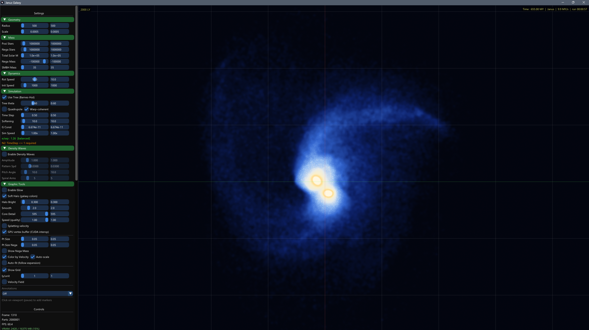
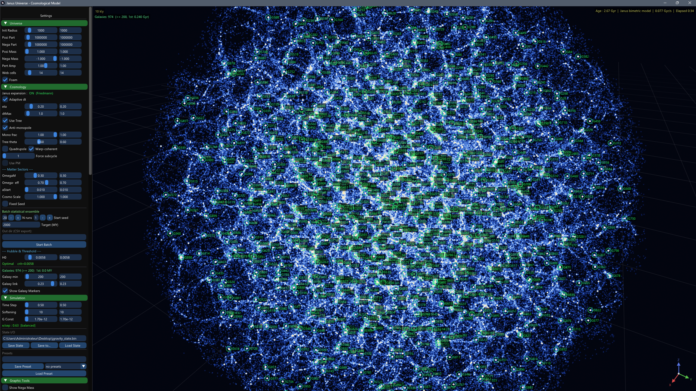

# Janus Simulation

GPU-accelerated N-body simulators for the **Janus cosmological model** of
Jean-Pierre Petit and collaborators: one application for a disk galaxy embedded
in a negative-mass halo, and one for cosmological large-scale structure.

> **Scientific status — read this first.** These are **experimental research
> tools**, built to support research on the Janus model, not to assert it. The
> model is an alternative to ΛCDM based on positive and negative masses; it has
> **not been validated** by the wider scientific community.
> Results produced with these programs require independent verification and
> peer review before they can be used as evidence. This repository is not an
> official implementation of the model. See
> [SCIENTIFIC_STATUS.md](SCIENTIFIC_STATUS.md) for the full statement and
> references.

The project exists to give the Janus model a concrete, inspectable implementation of its force law and
a subset of its numerical machinery: a way to visualize the model and generate predictions that can be
compared with observations. It is meant to **support scientific evaluation of the model, not to replace
it**.

Both applications are written in C++17 with CUDA, OpenGL 3.3, SDL2 and Dear ImGui.
The current build runs on Windows and is intended for interactive exploration of the Janus force law,
not for production-grade numerical campaigns.

| Application | What it simulates | Main tools |
|---|---|---|
| **Janus Galaxy** | A rotating positive-mass disk, a negative-mass halo and a central black hole | Barnes-Hut tree or direct N², SPH/Soft Halo, rotation curve, phase space, barycenters, Fourier modes, FoF halo finder |
| **Janus Universe** | A cosmological volume with Friedmann expansion, positive and negative species | Particle-Mesh (cuFFT) or tree, batch runs, galaxy detection, P(k), expansion history, T-web and temperature maps |

## Gallery

**Janus Galaxy — a positive-mass disk in a negative-mass halo**



**Janus Universe — cosmic web and galaxy detection**



Screenshots from the Windows build.

## Performance envelope

The prebuilt binaries are compiled for **compute capability 8.9** (RTX 40-series) and optimized for
laptop-class GPUs. The reference machine is an **RTX 4090 Laptop with 16 GB of VRAM**.

- At **2 million particles total** (1 M positive + 1 M negative), Janus Galaxy measures **8.8–16.8 FPS**
  (reference build 8.8–11.2; optimized build 11.9–16.8) and Janus Universe **11–14 FPS** at
  2 560 × 1 440.
- A 5-million-particle Janus Galaxy run was measured at **3.7–4.8 FPS**.
- **Above about 2 million particles**, a larger desktop or workstation GPU with more VRAM and compute
  is required for practical simulation work. The laptop can still run 5 M particles, but at ~4 FPS.
- **40 million particles and beyond** is the target of the HPC scaling roadmap, not the current build.

The user guides contain the full measurements, thermal notes and recommended settings.

## HPC scaling roadmap

[`docs/Janus Universe — HPC Scaling Roadmap.pdf`](docs/Janus%20Universe%20%E2%80%94%20HPC%20Scaling%20Roadmap.pdf)
sets out what would be required to move from the current single-GPU, ~2-million-particle interactive
regime to **40 million particles on a single large-memory GPU, and to billions on multi-GPU and
supercomputer systems**.

It is a **roadmap, not a description of the current build**. It covers block time-stepping, 2LPT and
zoom-in initial conditions, distributed FFT, MPI, subhalo finders, baryonic physics, parallel I/O and
in-situ analysis, with risks and a validation plan. The Markdown source is
[`docs/HPC Scaling Roadmap.md`](docs/HPC%20Scaling%20Roadmap.md).

> **PM-grid note.** The 512³ grid is not a 16 GB option: its padded FFT buffers, density grids and force
> fields total **~17 GiB plus cuFFT workspace**. On the 16 GB reference laptop, use **64³–256³**.

## Platform support and contributions

| Platform | Status |
|---|---|
| **Windows x64** | Supported; prebuilt binaries and build instructions. |
| **Linux x86_64** | **Wanted.** The CUDA, SDL2 and OpenGL stack is available; the build system and window layer need a port. |
| **macOS** | **Wanted, but a larger project.** Modern macOS has no NVIDIA CUDA support, so the CUDA kernels and cuFFT solver need a Metal, OpenCL or CPU backend. |

**Contributors are needed for the Linux and macOS ports.** The current code is Windows-only: the CMake
files copy `.dll` files, the build assumes MSVC and vcpkg, the icon uses a Windows resource file, and
the CUDA path is compiled with the Windows CUDA toolkit. A Linux port is the more direct of the two; a
macOS port also requires replacing the GPU compute backend.

If you can help, open an issue titled **“Port to Linux”** or **“Port to macOS”** and describe the
platform, compiler and GPU you can test. See [CONTRIBUTING.md](CONTRIBUTING.md) for the porting notes
and the kind of changes involved.

## Downloads

Prebuilt Windows x64 archives are attached to the
[Releases](https://github.com/AlexandreQ1/janus-simulation/releases) page:

- `Janus-Galaxy-win64.zip`
- `Janus-Universe-win64.zip` — requires the NVIDIA CUDA Toolkit 13.1 (cuFFT)
- `Janus-Universe-win64-full.zip` — includes the cuFFT runtime, for machines without the toolkit

Each archive contains the executable and its bundled runtime DLLs, the OpenGL
shaders, the equation templates, the author's `cfg`, the user guide and the
third-party notices. The standard Universe archive still needs the CUDA Toolkit
13.1 for cuFFT; the `-full` archive bundles that runtime. Unzip the whole folder
and run the `.exe` from inside it: the shaders and the configuration file are
resolved relative to the working directory.

> **GPU note.** The prebuilt executables are compiled for **compute capability 8.9**
> (RTX 40-series). On another NVIDIA GPU, rebuild from source with
> `-DJANUS_CUDA_ARCH=<your SM>`. The source builds without the 3Dconnexion SDK;
> SpaceMouse support is an optional build flag.

## Documentation

- `docs/User Guide — Janus Galaxy.pdf` — controls, navigation, analyses, replay, state, cfg.
- `docs/User Guide — Janus Universe.pdf` — cosmology, PM/tree, batch, galaxy detection, analyses.
- `docs/Janus Galaxy — Technical & Scientific Reference.pdf` — physics, kernels, memory, stability.
- `docs/Janus Universe — Technical & Scientific Reference.pdf` — cosmology, ICs, PM-FFT, tree, stability.
- `docs/Janus Universe — HPC Scaling Roadmap.pdf` — work packages for 40 M–10⁹+ particles, from a
  single large-memory GPU to multi-GPU and supercomputer systems; a roadmap, not the current build.
- [SCIENTIFIC_STATUS.md](SCIENTIFIC_STATUS.md) — scientific status, performance envelope and
  references, including Jean-Pierre Petit's papers.

The guides are written in English, without images.

## Repository layout

```
galaxy/        Janus Galaxy sources (CMake project)
universe/      Janus Universe sources (CMake project)
docs/          user guides, technical references, HPC roadmap
BUILDING.md    Windows build instructions
CONTRIBUTING.md  ports, build reports, pull-request rules
SCIENTIFIC_STATUS.md
LICENSE        MIT licence for this repository
THIRD_PARTY_NOTICES.md
```

Each application folder contains `src/`, `render/`, `gpu-nbody/`, `equations/`,
`CMakeLists.txt`, `app_icon.rc` and `janus.ico`.

## Building from source (short version)

Requirements: Windows 10/11 x64, Visual Studio 2022 (C++ x64 + CUDA), CUDA Toolkit
13.1, CMake 3.18+, and vcpkg with `sdl2 glew glm imgui` installed for the
`x64-windows` triplet.

```powershell
vcpkg install sdl2 glew glm imgui --triplet x64-windows

cmake -S galaxy -B build/galaxy -G "Visual Studio 17 2022" -A x64 `
  -DJANUS_VCPKG_ROOT="C:/path/to/vcpkg/installed/x64-windows" `
  -DJANUS_CUDA_ARCH=89
cmake --build build/galaxy --config Release --target j-gravity

cmake -S universe -B build/universe -G "Visual Studio 17 2022" -A x64 `
  -DJANUS_VCPKG_ROOT="C:/path/to/vcpkg/installed/x64-windows" `
  -DJANUS_CUDA_ARCH=89
cmake --build build/universe --config Release --target j-gravity-universe
```

See [BUILDING.md](BUILDING.md) for the full procedure, the optional 3Dconnexion
build and troubleshooting.

## Configuration and state

Both programs write their `cfg` only on a **clean exit** (`Esc` or the window
close button). A forced kill loses the changes made since the last exit. The
prebuilt archives include the author's `cfg` as-is; the `State` path inside it
points to the author's Desktop and can be edited in the application or in the
file.

## Scientific status and references

These are independent, experimental tools for research on the Janus model. The
model is the work of Jean-Pierre Petit and collaborators; it has **not been
validated** by the wider scientific community. Numerical results from this
repository are not evidence for the model until they have been independently
reproduced and peer-reviewed.

Key references:

- **Jean-Pierre Petit — official site and publication list**
  <https://www.jp-petit.org/>
- **J.-P. Petit & G. d'Agostini — *The Janus Cosmological Model* (2025 overview)**
  <https://www.jp-petit.org/papers/cosmo/2025-04-25-The-Janus-Cosmological-Model.pdf>
- **J.-P. Petit, F. Margnat & H. Zejli — *A bimetric cosmological model based on Andreï Sakharov's
  twin universe approach***, *Eur. Phys. J. C* **84**, 1226 (2024)
  <https://doi.org/10.1140/epjc/s10052-024-13569-w> · preprint
  <https://arxiv.org/abs/2412.04644> (arXiv spelling: “Andrei”)
- **J.-P. Petit & H. Zejli — *Janus Cosmological Model Mathematically & Physically Consistent***
  (HAL preprint, 2024) <https://hal.science/hal-04583560>

[SCIENTIFIC_STATUS.md](SCIENTIFIC_STATUS.md) contains the full statement, the measured performance
envelope and the reference list. The technical references describe the equations and the
numerical choices in detail.

## License

The source code of this repository is released under the **MIT License**; see
[LICENSE](LICENSE). Third-party components and their notices are listed in
[THIRD_PARTY_NOTICES.md](THIRD_PARTY_NOTICES.md).

## Credits

- Janus cosmological model: Jean-Pierre Petit and collaborators.
- Project origin: 42 School Silicon Valley.
- Windows port and current application: Alexandre.
- Built with SDL2, GLEW, GLM, Dear ImGui and NVIDIA CUDA.
- Optional 3Dconnexion SpaceMouse support uses the 3Dconnexion SDK under its
  own licence; see `THIRD_PARTY_NOTICES.md` and the About window of the
  SpaceMouse-enabled build.
